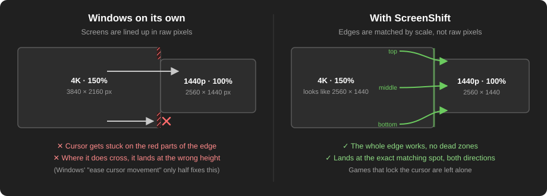
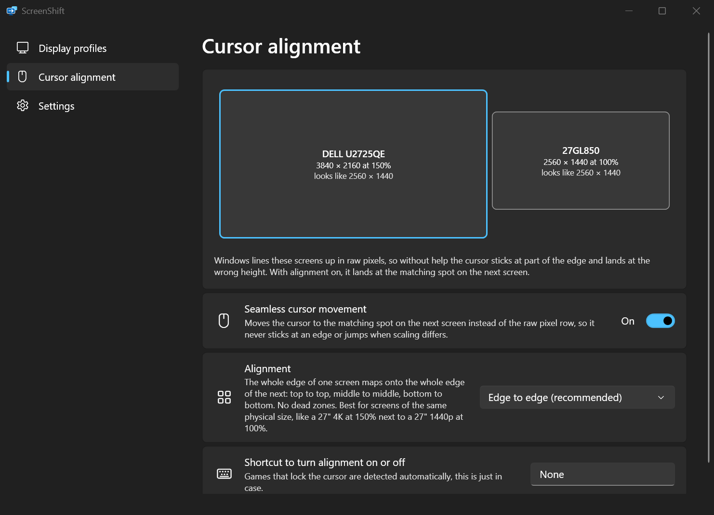
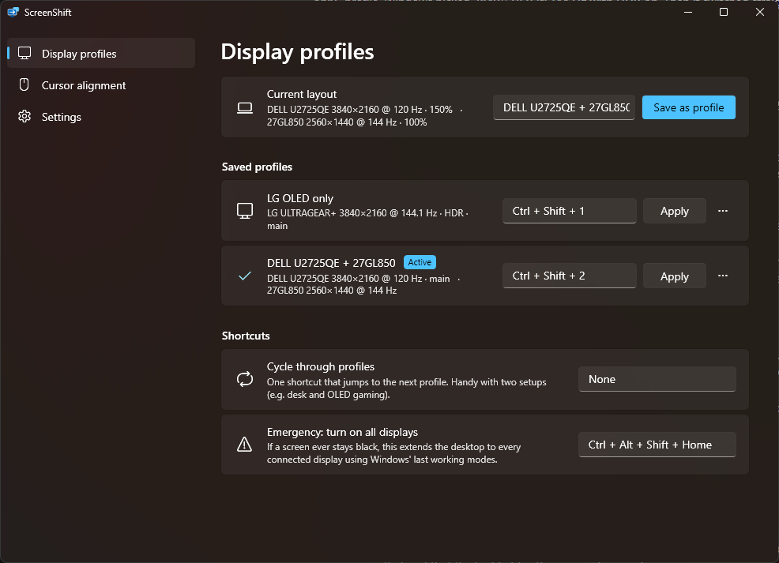
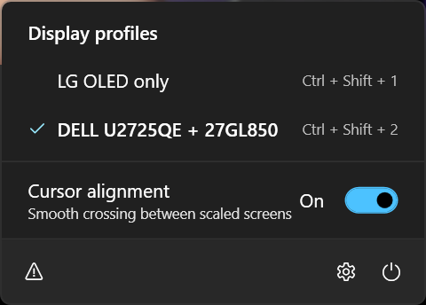
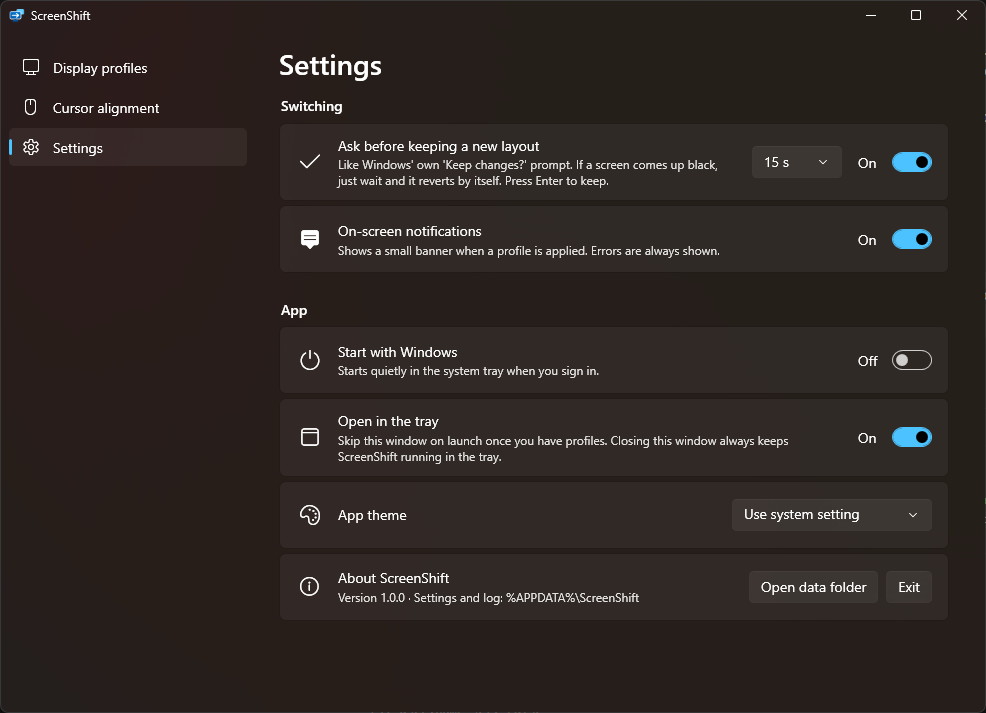

# ScreenShift

**Switch monitor setups with one key, and get a mouse cursor that finally moves between differently-scaled screens the way you'd expect.**


ScreenShift is a small Windows 11 tray app that saves your display layouts as profiles, switches between them with hotkeys,
and protects you from the "black screen after switching" problem. Its headline feature is **DPI-aware cursor alignment**.



---

## ⭐ The highlight: cursor alignment

Put a **27" 4K screen at 150 %** next to a **27" 1440p screen at 100 %**. Both are physically the same size and both "look like"
2560 × 1440, so the cursor should glide straight across. It doesn't, because Windows lines screens up in **raw pixels**:

- The 4K edge is 2160 px tall but the 1440p edge is only 1440 px, so part of the edge is a **wall** and the cursor gets stuck.
- Where it does cross, it keeps the same *pixel row*, so it lands **at the wrong height** on the other screen.
- Windows 11's own "Ease cursor movement between displays" helps a little, but its results are inconsistent.

ScreenShift watches for the moment the cursor leaves a screen and places it at the **matching spot** on the next one:
top to top, middle to middle, bottom to bottom, in both directions, along the whole edge.

Measured on a real 4K @ 150 % + 1440p @ 100 % setup (1440p offset 314 px down, moving right from the 4K):

| Cursor leaves the 4K at | Windows 11 alone lands at | ScreenShift lands at | Exact matching spot |
|---|---|---|---|
| y = 100 (near the top) | 371 | **381** | 381 |
| y = 2000 (Windows' dead zone) | 1696 | **1648** | 1648 |



**Two alignment styles**

| Style | Best for |
|---|---|
| **Edge to edge** (default) | Screens of the same physical size (e.g. 27" 4K + 27" 1440p). The full edge of one maps onto the full edge of the other. No dead zones. |
| **Match scaling** (top, centered or bottom) | Screens of different physical sizes. Moves the same real distance using each screen's scale factor. |

**It stays out of the way**
- Games and apps that lock the cursor (`ClipCursor`) are detected and left alone.
- The hot path (cursor staying on one screen) is two integer compares: no system calls, no allocations.
- The hook runs on its own thread, so the UI or a display switch never makes the mouse stutter.
- If Windows ever drops the hook (it does this to slow hooks), a watchdog reinstalls it.
- Optional hotkey to turn it on or off.

---

## Display profiles with hotkeys

Set your screens up once in Windows Settings (which screens are on, resolution, refresh rate, HDR, position), press
**Save as profile**, and give it a shortcut. Repeat for each setup: desk, OLED gaming, TV, and so on.



- One hotkey per profile, plus an optional **Cycle through profiles** hotkey.
- Remembers **HDR on/off** per monitor.
- Profiles survive reboots and driver updates (see below).
- **⋯ > Update with current layout** to re-save a profile after tweaking it.

## Black-screen protection

The reason this app exists: other switchers sometimes left an OLED black or crashed the PC. ScreenShift is defensive:

- **Won't switch if a monitor in the profile is off or unplugged.** You get a message and nothing changes.
- **Does nothing if the layout is already active,** so the screen doesn't blank and re-sync for no reason.
- **Remaps graphics adapter IDs.** Windows gives the GPU a new internal ID on every reboot and driver update. Applying a stale one is a classic cause of failed or black switches.
- **Validates with Windows before applying,** and falls back to Windows' own known-good timings if the saved ones are rejected.
- **Verifies every screen came on** afterwards.
- **"Keep these display settings?"** prompt with a countdown. If you see nothing, do nothing: it reverts by itself.
- **Emergency hotkey** (default `Ctrl + Alt + Shift + Home`) turns on every connected display.

## Lives in the tray

Click the tray icon for a Windows 11-style flyout: switch profiles, toggle cursor alignment, or open settings.





## Updates built in

ScreenShift checks this repo's [Releases](../../releases) once a day. When there's a new version you get a notice on screen,
in the tray flyout and in **Settings > Updates**. Click **Install update** and it:

1. downloads the release zip from GitHub,
2. verifies it against GitHub's SHA-256 checksum and checks that the exe is the expected version,
3. closes, swaps in the new files and starts again. Your profiles and settings are kept.

Nothing is installed until you click. If anything goes wrong mid-update, the old files are restored and the old version
restarts. You can turn the daily check off and use **Check for updates** whenever you like.

---

## Install

1. Install the [.NET 10 Desktop Runtime](https://dotnet.microsoft.com/download/dotnet/10.0) (x64) if you don't have it.
2. Download `ScreenShift-*-win-x64.zip` from [Releases](../../releases), unzip it anywhere, and run `ScreenShift.exe`.
3. Optional: in ScreenShift > Settings, turn on **Start with Windows**.

Notes:
- Runs as a normal user. No admin rights, no installer. The only network access is the update check (see below), which you can turn off.
- The exe isn't code-signed, so Windows SmartScreen may show "Windows protected your PC" the first time.
  Choose **More info > Run anyway**.
- Windows 11 hides new tray icons behind the **^** arrow. To pin it: Settings > Personalization > Taskbar >
  Other system tray icons > ScreenShift.

## Quick start

1. Arrange your screens in Windows Settings > Display.
2. In ScreenShift, press **Save as profile**.
3. Click the shortcut box on the profile and press a key combo (Backspace clears it).
4. Repeat for every setup, then close the window. ScreenShift keeps running in the tray.

---

## How it works

**Display switching** uses the Windows CCD API (`QueryDisplayConfig` / `SetDisplayConfig`), the same one the
Settings app uses. A profile stores the raw path and mode arrays plus, for each monitor and adapter, its stable
device path. On apply, ScreenShift:

1. maps saved adapter IDs to the current ones by device path (and connector IDs by monitor device path),
2. refuses if any monitor isn't connected,
3. skips if the layout already matches,
4. validates (`SDC_VALIDATE`), then applies; if that fails, retries with topology only so Windows picks the modes,
5. checks the result, then restores HDR state per monitor.

**Cursor alignment** is a low-level mouse hook (`WH_MOUSE_LL`) on a dedicated thread with its own message loop.
The process is Per-Monitor-V2 DPI aware, so all coordinates are physical pixels. When a move would leave the current
screen, ScreenShift finds the neighbouring screen(s) on that edge, maps the position along the edge (proportionally,
or by scale factor), calls `SetCursorPos` and swallows the original move. The layout cache refreshes on
`WM_DISPLAYCHANGE`.

**Resource use** (measured on Windows 11, idle in the tray): about 6–9 MB working set and 0 ms CPU over 10 s.
Windows are created once and then hidden and reused, because WPF leaks a few OS handles every time a window is
destroyed. Opening the settings window or the flyout repeatedly keeps memory and handle counts flat.

**Storage:** settings and profiles are in `%APPDATA%\ScreenShift\settings.json`. Writes are atomic
(temp file, then replace) with a backup kept, so a crash can't corrupt your profiles. `log.txt` in the same folder
records every switch, which helps when something goes wrong.

## Build from source

Requires the [.NET 10 SDK](https://dotnet.microsoft.com/download/dotnet/10.0).

```bash
dotnet publish -c Release -o publish
```

The UI is WPF with the built-in Windows 11 (Fluent) theme. There are no NuGet dependencies.

## Command line

| Option | What it does |
|---|---|
| `--tray` | Start hidden in the tray. |
| `--selftest` | Checks the cursor-mapping maths and lists every connected display, including ones that are off. Writes `%APPDATA%\ScreenShift\selftest.txt`. |
| `--update-dryrun` | Checks GitHub for a newer release, downloads and verifies it, but doesn't install. Writes `%APPDATA%\ScreenShift\update-dryrun.txt`. |
| `--make-solo-profile <targetId> "<name>"` | Creates a profile with only that display on (target IDs come from `--selftest`), then switches back. Your screens blank briefly. Close the running ScreenShift first. |

## Limitations

- Windows doesn't let normal apps move the cursor while an **app running as administrator** (Task Manager etc.) has focus, so normal Windows behaviour applies there.
- Windows 11 only (it may work on Windows 10, but that's untested).
- Virtual display drivers (from VR, streaming, or Android-emulator software) are a common source of display-switching trouble in general. If you don't use them, disabling them in Device Manager can help.

## License

[MIT](LICENSE)
